# 知乎阅读 · Kindle 原生客户端

一个跑在**越狱 Kindle 上、只靠 Kindle 自己**运行的知乎阅读器。

它**不是 KOReader 插件**，也不是网页套壳，更不需要电脑、手机或中转服务器配合：一个静态链接的 ARM 可执行文件，直接操作 Kindle 的帧缓冲、直接读触摸屏与实体按键、自己在设备上完成 DNS / TLS / 请求签名 / 正文清洗 / 中文排版，翻页是整页翻页，和看书一样。

```
程序：/mnt/us/zhihu/zhihu      约 2.1 MB，静态链接，无任何运行时依赖
数据：/mnt/us/zhihu/           配置、Cookie、缓存、日志
入口：KUAL → 知乎阅读            （或 SSH 直接执行）
```

## 下载安装（不需要自己编译）

最新版本 **1.2.9**，到 [Releases](https://github.com/asuplive/zhihu-kindle-native/releases/latest) 下载：

| 文件 | 用途 |
|---|---|
| `zhihu-Kindle-1.2.9.zip` | 完整安装包：程序 + KUAL 菜单 + 启动脚本 + 全部文档与源码 |
| `zhihu` | ARM 静态可执行文件本体（仅调试/手动替换用） |

安装：解压后把 `extensions/zhihureader` 整个目录复制到 Kindle 的 `/mnt/us/extensions/`，KUAL →「知乎阅读」→「安装 / 更新程序」→ 点「知乎阅读」启动。详见压缩包里的 `安装说明.txt`。

**要求**：已越狱的 Kindle（推荐 Kindle Oasis 3，1264×1680；其他型号可自行按 `src/fb.h` 里的参数适配），已装 KUAL。

> **1.2.13**：真机六修。① 顶栏时间冒出：压屏改 500ms 节流（原 3 秒盲退避导致顶栏停留 3 秒）；② **返回键层级化**：回答页→回答列表→热榜→主页，不再一键回主页；③ 私信消息：新增 App 端（api.zhihu.com）真实路由候选 + 绝对 URL 支持 + 200-解析失败诊断；④ 关于页加 GitHub 地址；⑤ **修复点按加载图片后画面冻结**（SCR_LOADING 未恢复）；⑥ 回答列表去掉重复问题标题，摘要为主体（推荐列表不变）。详见[变更说明-1.2.13.md](变更说明-1.2.13.md)。
>
> **1.2.12**：推荐/回答列表双布局 + 标题再放宽。① 设置新增「列表样式」开关：**详细**（默认：问题标题加粗 → 回答摘要固定 2 行 → 作者赞同浅灰，行高拉开留白充足）与**简洁**（标题+作者赞同，行高小适合快速划）；摘要固定 2 行截断，行高恒定不跳页。② **以问题优先展示**：回答条目不再把摘要放在标题位（1.2.5 起的做法），标题改为问题标题优先，摘要独立成字段画在下面。③ 阅读页标题折行上限 3 行 → **8 行**，知乎长问题标题（100+ 字）也完整显示。详见[变更说明-1.2.12.md](变更说明-1.2.12.md)。
>
> **1.2.11**：修 1.2.10 真机反馈的三个排版问题。① **文章尾部空白页（主修）**：`layout.c` 分页数组收尾把 `pages[pn]` 留成了 calloc 的 0 且 `npages` 多算一页——内容 4 页的文章显示"共 5 页"且第 4、5 页全空白，内容 1 页的文章两页全空；修复后 `[lay2]` 自检钉死"每页行区间非空、首行落在页内、末页终点=总行数"。② **阅读页标题完整显示**：标题按宽度自动折行（最多 3 行，页眉高度自适应），不再一行截断加省略号。③ **回答列表三行预览**：点热榜问题进去的 20 条回答列表，每条先露前三行摘要（行高自适应、摘要加长到 140 字），看得到写得怎么样再决定点不点进去。详见[变更说明-1.2.11.md](变更说明-1.2.11.md)。
>
> **1.2.10**：修 1.2.9 真机上的**整机重启**回归。根因：1.2.9 把「隐藏系统状态栏」实现成了杀 cvm（`showbar=0 → framework=stop`），cvm 一死 Kindle 的 framework 看门狗就在宽限期后整机重启（`run.log` 的 boot_id 自证两次重启，`log.txt` 戛然而止无 CRASH 是被 SIGKILL 的特征）——你点热榜/关于时正好撞上宽限期，其实跟点什么没关系。改法：① **showbar 与 framework 解耦**：默认改回 `showbar=1`（共存），选"隐藏（压屏）"也不再杀 cvm，顶栏残留由屏幕守护（影子回灌，120ms 一拍）压掉；② **删除 `.want_stop` 自动升级 stop** 的隐藏通道；③ 显式 `framework=stop` 保留但加三重保险：**600 秒超时自动恢复共存**（`fwback=` 可配）、**崩溃处理器退出前恢复 framework**、正常退出恢复（已有）；④ **刷新可定位**：MXCFB SEND_UPDATE 前写 breadcrumb 进 `fb_trace.log`（内核 panic 不留 CRASH 行，最后一行就是嫌疑参数）、FBIOPAN 分支加编译期警示、心跳行新增 `fw=coexist/stop Ns` 字段。自检 36 项不变，verify_release 新增 8 项专项检查。详见[变更说明-1.2.10.md](变更说明-1.2.10.md)。
>
> **1.2.9**：按真机反馈改 10 处——① **系统状态栏开关**：设置里可选隐藏（默认），隐藏时 `start.sh` 直接接管 framework（`showbar=0 → CF_MODE=stop`），时间/网络/电量顶栏彻底不再露出，切换需重启生效；② **物理翻页键不再串扰**：与 ① 同根，按键随 framework 接管被本程序独占，阅读页=翻页、列表页=下翻，不再串出原生书城/搜索框；③ **推荐条数可配**：6/12/18（6 的倍数、最多 18）；④ **图片解码修复**：按文件头分流，新增 PNG/GIF/BMP（stb_image.h）与 WebP（libwebpdecoder），大图按 `IMG_MAX_PIXELS`（2000 万像素）限尺寸不再卡死，加载失败留在文章页显示原因、不再被踢回首页；⑤ **图片缓存按文章分目录**：`cache/img/<md5(文章key)>/<md5(url)>_宽.zhg`，返回再进瞬时加载，兼容旧平铺缓存，设置里新增「清空缓存」；⑥ **翻页刷屏新增 Regal 模式**（实验）：Kindle 独有 REAGL 残影补偿波形（`WAVEFORM_MODE_REAGL 0x8`），被固件拒绝自动回退 GC16；⑦ **KO3 翻转设备触摸同步**：每秒轮询内核旋转角，画面与触摸映射一起补偿，`autorot=0` 可关；⑧ **私信详情 404 修复**：实测确认 `/api/v4/messages?thread_id=` 与 `/api/v4/me/message-threads` 可用（老 `/api/v4/inbox/{id}/messages` 是 nginx 级 404），候选端点重排并钉进自检；⑨ **KUAL 菜单精简**：第一项只剩「知乎阅读」直接启动，其余 7 项收进「诊断和排障」；⑩ **阅读页只有第一页显示标题**：排版改双页高（`layout_build2`），后续页整页正文、页眉只剩细分隔线+小页码。自检 34 → 36 项。详见[变更说明-1.2.9.md](变更说明-1.2.9.md)。
>
> **1.2.8**：修真机反馈的三件事——① **各界面文字重叠**：KO3 走的是 `eips` 后路，而 `eips -g` 默认是**局部更新**，不擦底，换一次界面就叠一层。现在换屏一律 `eips -f -g`（全刷），翻页才用局部并每 3 次补全刷；② **有的界面发虚、字不清**：`fast=1` 时翻页走 DU(A2) 二值化波形，灰阶抗锯齿被量化掉，改为 GC16+PARTIAL（不闪屏但不掉层），DU 降级为 `du=1` 手写开关；③ **正文图片一直不出**：缓存文件名用**解码宽度**（竖长图会被 `max_h` 压窄，如 679），查缓存却用固定 `IMG_CACHE_W`（1024），永远查不到——存盘改成固定键，并加"存完回读"校验。另外把「显示图片」做成**三档**（关闭 / 点按加载 / 自动异步），点按档失败会把原因直接显示在屏幕上。自检 33 → 34 项。详见[变更说明-1.2.8.md](变更说明-1.2.8.md)。
>
> **1.2.7**：按真机验收反馈改 8 处——① **返回按钮统一到右下角**（列表 / 阅读 / 设置 / 账号 / 二维码 / 私信 / 关于，位置和样式完全一致；阅读页「点右侧翻页」收紧到正文区，不再误退）；② **阅读页标题放大**（1.2 倍正文、加粗，页眉跟着加高）；③ **图片改异步**：打开文章只取正文（毫秒级出字），图片在后台从第一张开始补，下好一张替换一个占位框、只刷当前页，阅读位置按「块 + 块内行号」锚定；④ **列表加「上一页 / 下一页」**（整页对齐，第 2 页首行就是第 14 条）；⑤ **推荐加「刷新」**，并改用 `paging.next` 续页（原来按 `page_number` 翻，三页给的是同一批）；⑥ **私信端点又错了**——`/api/v4/me/conversations` 实测是 nginx 404，改为 `/api/v4/inbox`，并优先用会话自带的 `url` 取消息；⑦ **收藏夹 404**——`/api/v4/collections/self` 早已下线，改为 `/api/v4/members/self/favlists`；⑧ **KUAL 改成一级分类 + 二级菜单**（启动与安装 / 诊断与排障），并新增「私信端点诊断」。自检 29 → 33 项。详见[变更说明-1.2.7.md](变更说明-1.2.7.md)。
>
> **1.2.6**：按真机验收反馈修 7 处——① 按**翻页键会闪出原生主页**（只抢了触摸屏独占，按键设备没抢，framework 照样收到键）；② 回答列表**每行都重复问题标题**（回答没有独立标题时退化成 `question.title`，改用该回答的摘要）；③ 正文顶部**缺作者/赞同/时间**（详情解析拿到了 `voteup_count`/`created_time`，却在写临时文件时被丢掉）；④ **推荐只有 6 条**（只拉一页，改成 3 页 × 20 条合并去重）；⑤ **私信永远打不开**（候选端点全错，改为 `/api/v4/me/conversations`）；⑥ **「我的收藏」只弹"需要登录"**（从未调用接口，现在真的拉收藏夹 → 内容 → 正文）；⑦ **「显示图片」只有 `[图片]` 占位**（内置只解亮度 Y 的基线 JPEG 解码器 + 下载缓存 + 图片参与整页排版，一张图不再被分页劈开）。自检从 21 项加到 29 项。详见[变更说明-1.2.6.md](变更说明-1.2.6.md)。
>
> **1.2.5**：修三处**互相独立**的毛病——① 屏幕翻转后**触摸不跟随**（显示走 `pix_off` 旋转，触摸却只在启动时写死 `(0,0,0)`，所以除 0° 外三个方向全反）；② 与系统界面共存时**偶尔看见桌面顶栏**（守护 1 秒一拍 + "重排版重画"，窗口太宽）；③ 热榜/推荐**点进去 404**——真因是**知乎的 id 已经是 19 位**，`json.c` 把它读成 `double` 再转 `long`（`2103784826771862921` → `…863040`），发出去的就是一个不存在的 id；32 位 ARM 上还会溢出成负数被丢掉。现在 id 一律按原始字面量取（`json_get_idstr`），并顺带加固链接解析、补桌面 UA/上下文 Referer/`x-zst-81`、404 退到问题回答列表。三条改法见[变更说明-1.2.5.md](变更说明-1.2.5.md)。
>
> **1.2.4**：解决 KO3 上"界面能用但不好用"——静置几分钟**弹「应用程序错误」**、**卡在主页点不动**、**点一下菜单整屏黑闪**。真机日志（`收到信号 15` / `rc=143`、`kmsg.log` 干净、无 `*** CRASH`）说明进程是被 userspace 杀的，根在「冻结 cvm 接管屏幕」这个模型：**冻住的 cvm 仍然攥着触摸屏的 `EVIOCGRAB` 独占**（所以点不动），而冻住的 UI 会被 framework 当成卡死、3~4 分钟后按进程组清场（所以弹错）。改法：先探测触摸独占再决定要不要接管、程序自己抢独占并补抢、退出还原从"只靠脚本"变成"程序也会"、菜单改 DU 快刷、每秒做一次屏幕归属守护。详见[变更说明-1.2.4.md](变更说明-1.2.4.md)。
>
> **1.2.3**：解决 KO3 上"界面出来了，静置两三分钟后**整机硬重启**"。1.2.2 把刷新路径修对之后，重启点挪到了**电源**上：停掉 framework 后没人再哄 `powerd`，设备到点自动挂起，而 5.x 在没有系统界面的情况下唤醒失败 → 硬件复位（日志里连 `*** CRASH` 都不留，`exit rc=` 也没有）。三条改动见[第六节第 0 条](#0打开后整机重启黑屏--转圈--重新开机12-3-修)。
>
> **1.2.2**：解决 KO3 上"一看到界面就整机重启"。真因是刷新 ioctl 的方向位写错了（`_IOW` 应为 `_IOWR`）……（1.2.3 的真机日志显示：方向位改正后 `SEND_UPDATE` **仍然全 EINVAL**，刷新改走系统 `eips`，重启则另有主因。）
>
> **1.2.1**：解决 KO3 上"点进去打不开"——启动脚本没把 `cvm` 杀干净（它继续往 framebuffer 上画，把界面盖掉），以及列表为空时错误被吞掉、屏幕上只剩一个「（空）」。

## 界面

| 首页 | 热榜（联网实时） | 阅读第 1 页（有标题） |
|---|---|---|
| 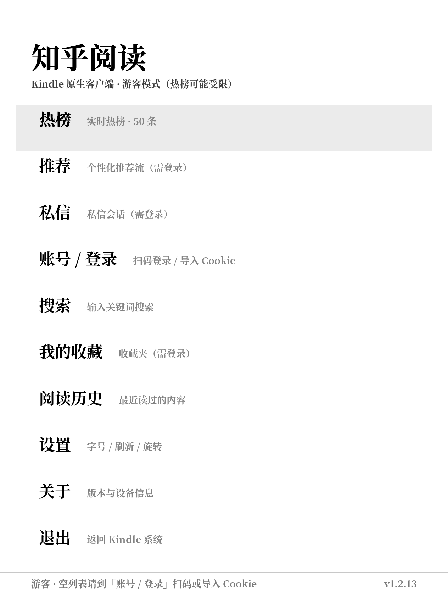 | 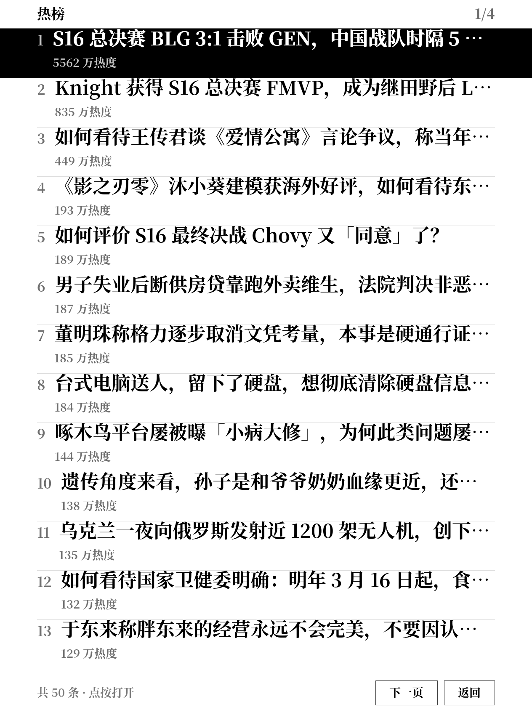 | 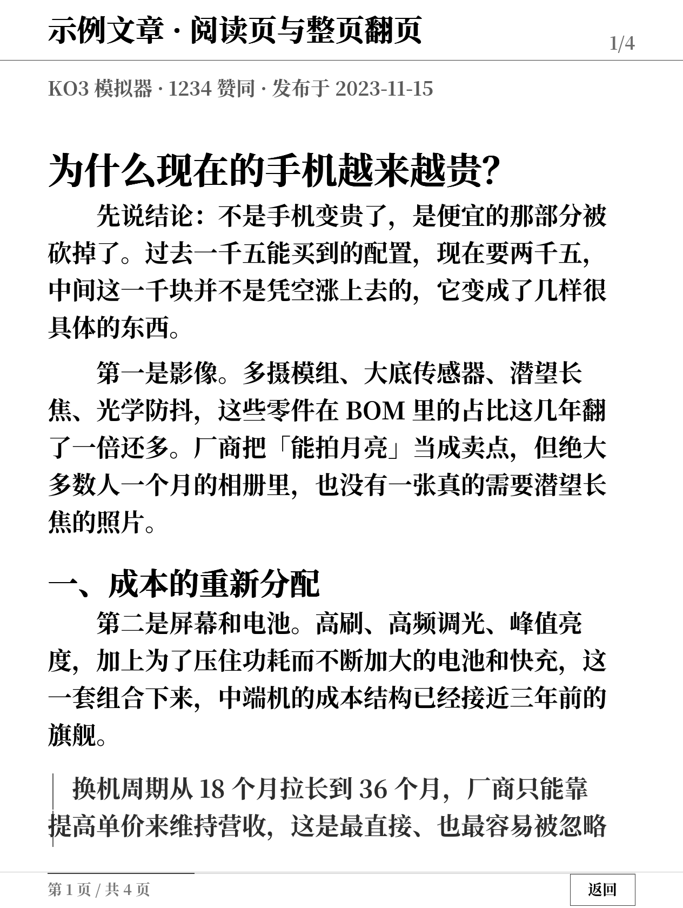 |

| 阅读第 2 页（无标题，整页正文） | 图片加载中 | 设置 · 10 项（含推荐条数/系统状态栏） |
|---|---|---|
| 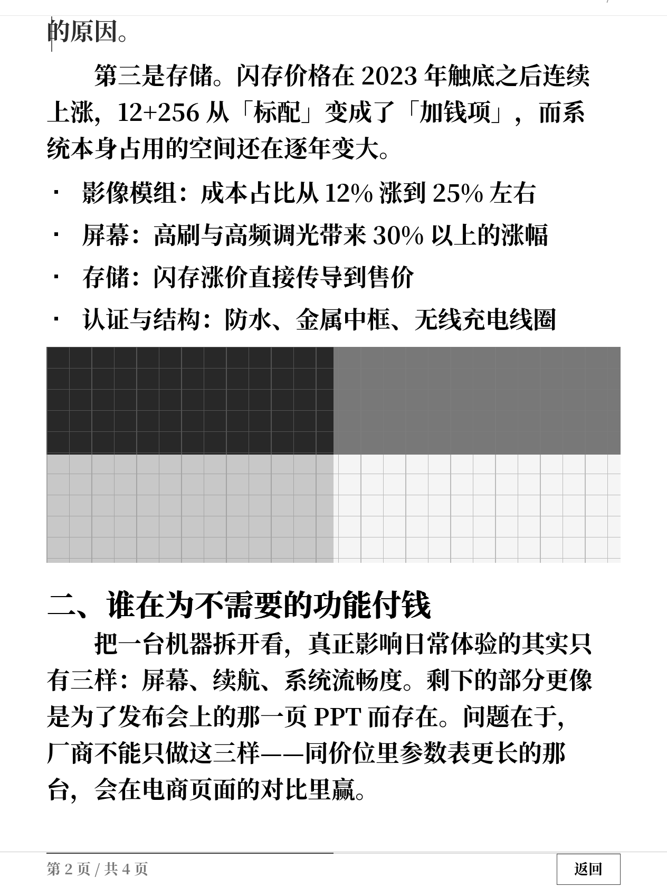 | 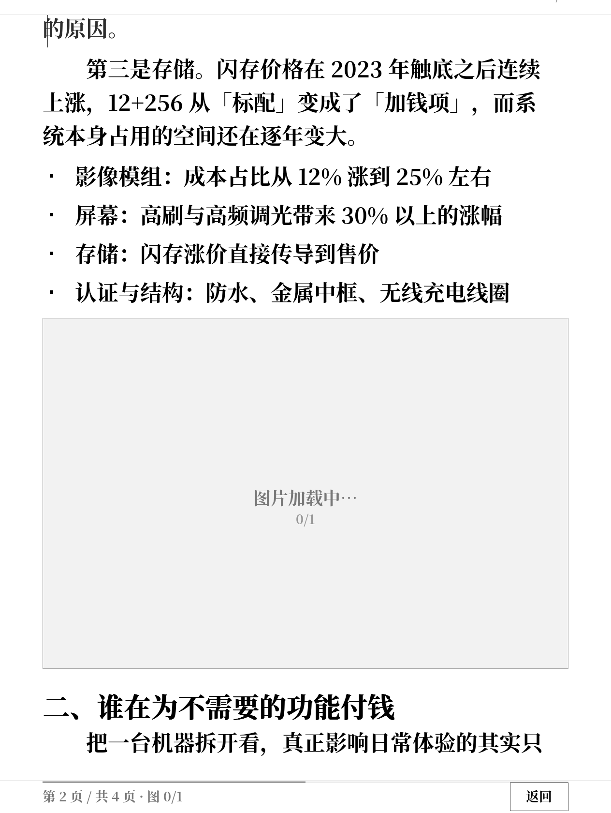 | 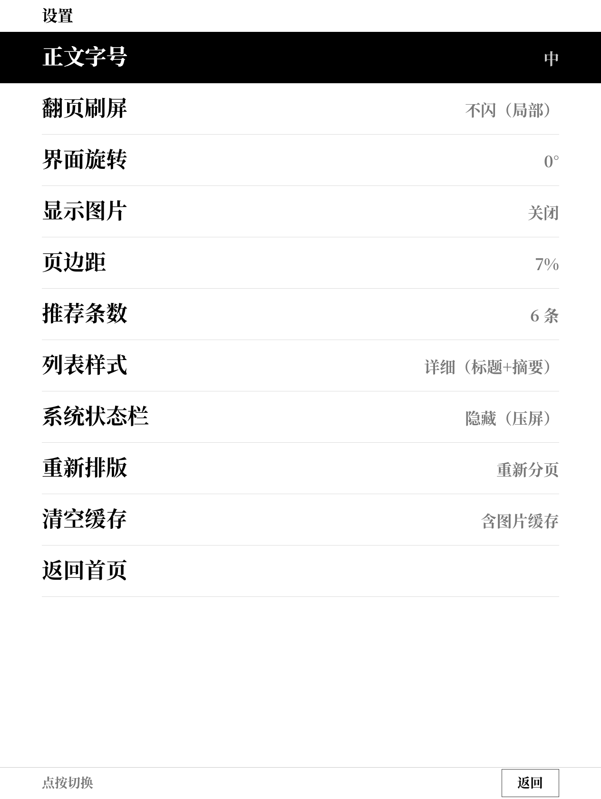 |

| 点按档占位框（1.2.7） | 图片异步补上（同一页） | 取不到内容时 |
|---|---|---|
| 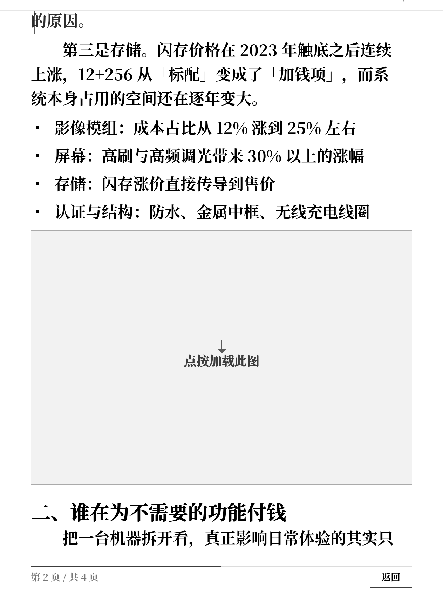 |  | 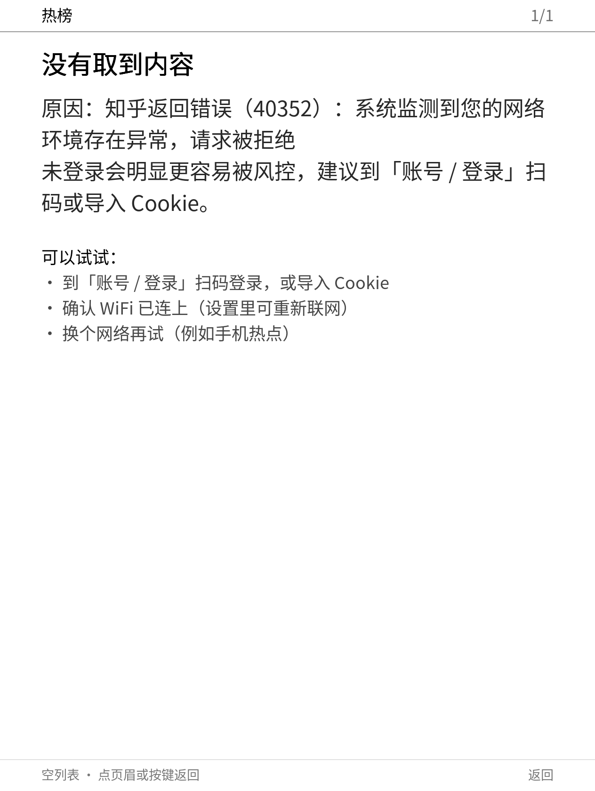 |

| 账号 / 登录 | 扫码登录（设备端本地生成） |
|---|---|
| 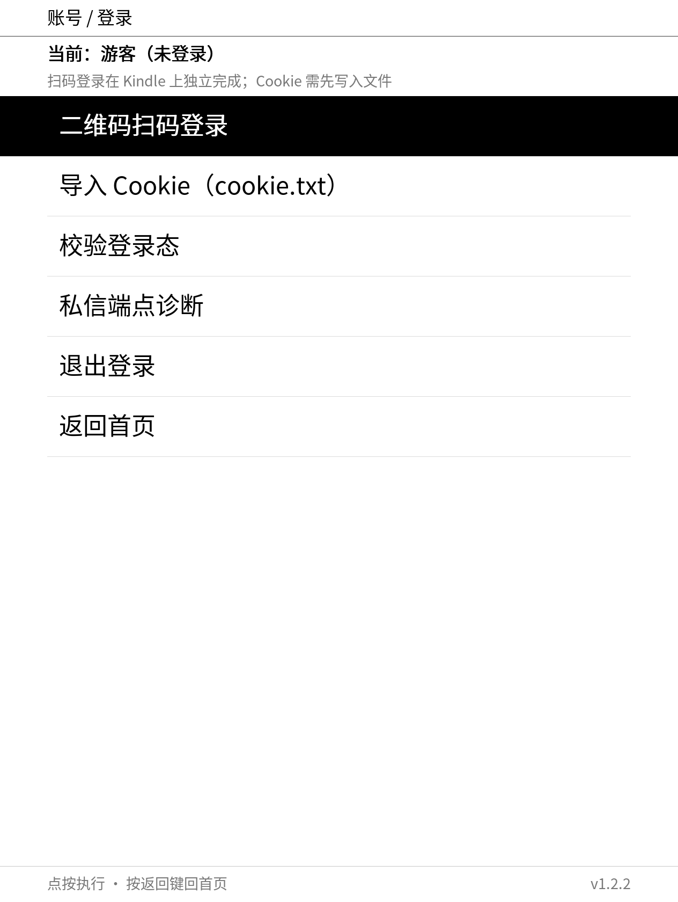 |  |

| 私信会话 | 私信消息（整页翻页） |
|---|---|
| 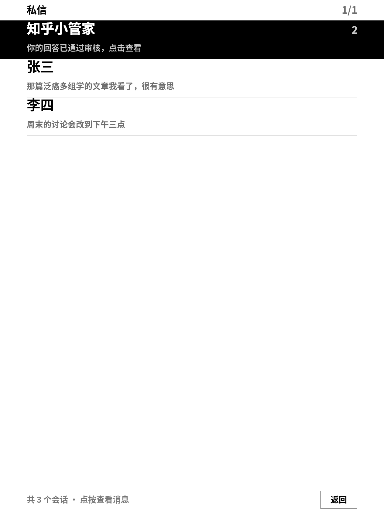 | 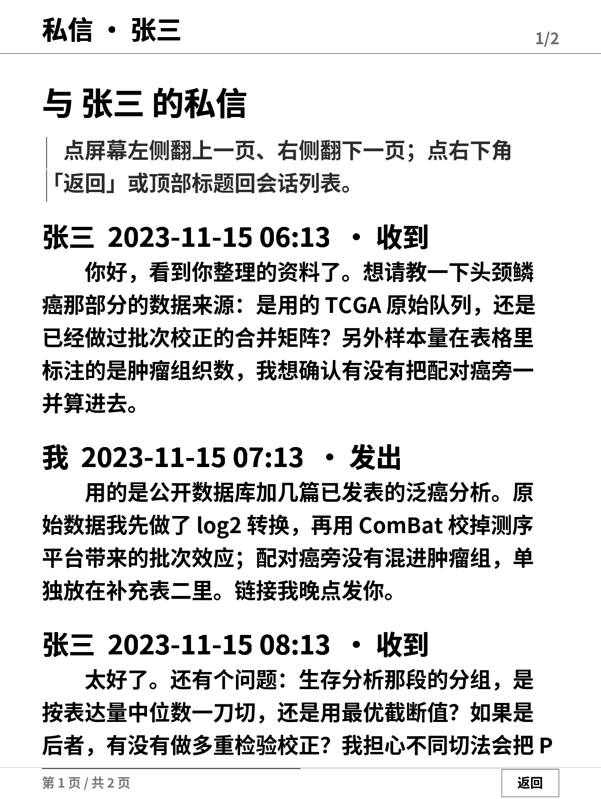 |

（以上为 1264×1680、8bpp 灰度屏的真实渲染输出，与 Kindle Oasis 3 / Paperwhite 5 同尺寸。「取不到内容时」这张是 1.2.1 的重点：风控、断网、未登录都会走到这一页，把原因和下一步写清楚，而不是留一片空白。二维码与私信两张为 KO3 模拟器内置的**离线演示帧**：二维码由设备端真实编码绘制，私信数据为本地注入，用于在没有登录态时验证版式；真机数据需登录后拉取。）

---

## 一、和「KOReader 插件」有什么不同

| | KOReader 插件版 | 本版（原生） |
|---|---|---|
| 运行方式 | 依赖 KOReader 这个宿主程序 | 独立进程，不需要任何宿主 |
| 界面 | 复用 KOReader 的 Widget 体系 | 自绘 framebuffer，全部界面自己实现 |
| 翻页 | 交给 KOReader 的 crengine 排版 | 自己排版、自己分页、自己刷屏 |
| 依赖 | 必须装 KOReader | 只需越狱 + KUAL（甚至 KUAL 也不是必需） |
| 体积 | 插件几百 KB | 单文件 1.9 MB（含 TLS、字体引擎、排版引擎） |

如果你之前装过插件版，两者互不冲突，可以都留着。

## 二、支持机型

二进制按 **ARMv5TE + 软浮点 ABI** 交叉编译并静态链接，这是 Kindle 全系（ARM）都能执行的指令集，不依赖设备上的任何 so 库：

- Kindle 4 / 5（Touch）、Paperwhite 1–5、Voyage、Oasis 1–3、Kindle 8/10/11 代、Scribe、Colorsoft
- 屏幕尺寸、DPI、是否有实体翻页键**全部运行时读取**，没有写死任何分辨率
- 触摸坐标按 `EVIOCGABS` 报告的范围归一化，横竖屏差异自动判断
- 电子墨水刷新走 i.MX EPDC 的 `MXCFB_SEND_UPDATE`；老机型自动退回"直接写 fb + 等 vsync"

> 说明：Kindle 的 kernel/glibc 版本差异较大，本项目在 Paperwhite 2 及以上（固件 5.x）为主要目标；Kindle 4/5 理论可用但未逐一实机验证。若在你的机器上无法启动，请把 `/mnt/us/zhihu/log.txt` 的内容反馈出来（KUAL 菜单里「查看运行日志」可直接在屏幕上看）。

## 三、安装

**前提**：Kindle 已越狱（Jailbreak + Hotfix，禁用 OTA），已装 KUAL。越狱方法以 [Kindle Modding Wiki](https://kindlemodding.org/) 为准。

1. 用 USB 把压缩包里的 `extensions/zhihureader` 整个目录拷到 `/mnt/us/extensions/`
   （最终路径是 `/mnt/us/extensions/zhihureader/{config.xml,menu.json,app/,bin/}`）
2. 拔出 USB，打开 KUAL → **知乎阅读** → **安装 / 更新程序**
   （把 `app/zhihu` 复制到 `/mnt/us/zhihu/zhihu` 并加可执行权限）
3. KUAL → **知乎阅读** → **打开知乎阅读**

也可以不用 KUAL，SSH 登录后直接跑：

```sh
sh /mnt/us/extensions/zhihureader/bin/start.sh run
```

**卸载**：删掉 `/mnt/us/extensions/zhihureader` 和 `/mnt/us/zhihu` 即可，不写系统分区。

## 四、用法

- **首页（10 项）**：热榜 / 推荐 / 私信 / 账号·登录 / 搜索 / 我的收藏 / 阅读历史 / 设置 / 关于 / 退出
  （行高按屏幕高度自适应，10 项在 6 英寸到 7 英寸机型上都不溢出）
- **列表页**：点条目打开；右下角「返回」退出；「上一页 / 下一页」整页翻（第 2 页首行就是第 14 条）；推荐列表另有「刷新」
- **阅读页**：
  - 点屏幕**左侧 1/4** → 上一页；其余区域 → 下一页（整页翻，不滚动）
  - 左右滑动也可以翻页（触摸机型）
  - 有实体键的机型：任意翻页键下一页，`←`/`↑` 上一页，`返回` 回列表
  - 底部有页码与进度条；**右下角「返回」**回列表（页脚这一条不再触发翻页）
  - 「显示图片」三档（设置里点一下循环）：
    - **关闭**：只留一行「[图片]」
    - **点按加载**：图片位置是「点按加载此图」的框，点哪张下哪张；失败原因直接显示在屏幕上
    - **自动加载**：文字先出来，占位框写「图片加载中… n/N」，后台从第一张开始补，补上就刷新当前页
- **设置**：字号（小/中/大）、翻页刷屏（不闪／整屏闪）、界面旋转 0/90/180/270、显示图片（关闭／点按加载／自动加载）、页边距、清缓存

### 登录（1.2.0 起：二维码 + Cookie 双通道）

游客能看热榜；**推荐、私信、收藏夹需要登录态**。首页点「账号 / 登录」，里面有两条通道：

**方式一：二维码扫码（纯设备端，推荐）**

1. 点「二维码扫码登录」，程序直接在 Kindle 屏幕上生成二维码（本地生成，不依赖服务器返回图片）
2. 每 2 秒自动查一次扫码状态，期间界面照常可点「返回」，不会卡住
3. 用**手机知乎 App** 扫屏幕上的码，在手机上点「确认登录」
4. 成功后再取用户名、把 `z_c0` 写入 `cookie.txt`，账号页显示登录用户

链路是网页端 `/signin → /udid → qrcode → scan_info`，全程在设备上完成，不需要电脑、不需要浏览器、不需要 Kindle 有中文输入法。二维码按屏幕尺寸自适应放大，每码元至少 3 像素，保证手机能扫出来。

**方式二：导入 Cookie（兜底，100% 可靠）**

扫码被风控（提示「网络环境存在异常 / 40352」）时改用这条。把知乎网页版 Cookie 存成**一行文本**：

```
/mnt/us/zhihu/cookie.txt
```

内容形如 `z_c0=xxxx; d_c0=yyyy; _xsrf=zzzz`（浏览器 F12 → Network → 任意请求 → Request Headers → Cookie 整段复制，**必须包含 `z_c0=`**）。然后回「账号 / 登录」点「导入 Cookie」，程序会请求 `/api/v4/me` 校验，并在屏幕上显示用户名或失败原因。直接启动也会自动读取该文件。

> **为什么没有「手机号 + 短信验证码登录」**：知乎的 `sign_in` 表单由前端 `encrypt.js` 加密（算法随版本变化），并会触发网易易盾滑块验证。Kindle 上是纯 C 帧缓冲程序，没有 WebView / JS 引擎，无法可靠完成，硬做也会很快失效。二维码与 Cookie 是网页端不依赖 JS 加密的两条可用链路。

**账号页其它项**：

| 项 | 作用 |
|---|---|
| 校验登录态 | 用 `/api/v4/me` 确认 Cookie 是否还有效，显示用户名 |
| 私信端点诊断 | 依次请求各候选私信端点，把 `status` 直接显示在屏幕上（同时写 `log.txt`） |
| 退出登录 | 清掉 `z_c0` 但保留 `d_c0` 设备标识，降低下次触发风控的概率 |

### 私信（只读，整页翻页）

首页「私信」→ 会话列表（对方昵称、最后一条摘要、未读数、页码）→ 点会话查看消息全文。消息复用阅读器的**整页排版与翻页**：点左侧 1/4 上一页、其余下一页，左右滑动可翻页，点页眉返回会话列表，底部有页码和进度条。

按确认的范围，目前**只看会话和消息，不能回复**——Kindle 没有系统中文输入法，程序自带软键盘只有英文/数字，做回复输入框没有实际意义。

私信端点在知乎不同版本间路径有差异，因此内置多个候选端点并按通用字段解析。真机上若读不到会话：

1. 在「账号 / 登录」点「私信端点诊断」，看哪个端点 `status=200`
2. 在 `/mnt/us/zhihu/social.conf` 里写死该端点，**改配置无需重编译**：
   ```ini
   threads=/api/v4/messages?limit=20&offset=%d
   messages=/api/v4/messages/{id}/messages?limit=20&offset=%d
   ```
   `%d` 是分页偏移，`{id}` 是会话 id
3. 把 `log.txt` 反馈给我，按真实返回结构适配解析

## 五、技术实现

### 5.1 显示

- `mmap(/dev/fb0)`，支持 8bpp 灰度、16bpp RGB565、32bpp
- 刷新：`ioctl(MXCFB_SEND_UPDATE)`，翻页用 `WAVEFORM_MODE_DU`（快），每 8 页补一次 `GC16` 清残影；设置里可切成"始终清晰"
- `MXCFB_SEND_UPDATE` 的 ioctl 号里带了结构体大小，而各代内核的结构体从 32 字节到 76 字节不等。启动时按 4 字节步进把 4~160 全扫一遍（正放/对调两种矩形、两档方向位、三档温度），用能返回成功的那个
- **探测失败不等于没救**：KO3（5.14.2）的内核拒收我们所有 `mxcfb_update_data`（全 `EINVAL`），但系统自带的 `eips` 刷得好好的。所以 `eink_kind=4` 时把整页像素写成 8bit 灰度 PNG，交给 `eips -g` 去推——渲染仍是我们自己的，eips 只当"往屏上搬像素的搬运工"；`eips -g` 不认就退 `eips -f`，再不行用 `FBIOBLANK` 脉冲
- 提交更新后**不阻塞等待**：个别固件的 `WAIT_FOR_UPDATE_COMPLETE` 不返回，等它等于把界面锁死
- 屏幕旋转做成软件坐标变换（设置里可调），应对个别机型 framebuffer 方向不同

### 5.2 输入

- `select()` 轮询 `/dev/input/event*`；设备被拔掉（`read` 返回 0/`ENODEV`）时立刻摘掉，否则 `select` 会一直返回可读、主循环空转把 CPU 打满
- 同时支持两代报点方式：
  - **A 类**：`ABS_X/ABS_Y` + `BTN_TOUCH`（K4/K5、PW1/PW2）
  - **B 类**：MT 协议 B，`ABS_MT_TRACKING_ID` + `ABS_MT_POSITION_X/Y`——**新固件很多不发 `BTN_TOUCH`**，只认它就会"点哪儿都没反应"
- 手指按下时不立刻记起点，等 `SYN_REPORT` 再记（MT 协议的坐标常在 `TRACKING_ID` 之后才到）
- 触摸范围用 `EVIOCGABS` 读取并按画布归一化；长宽比不匹配时自动交换 XY；用 64 位整数算，避免小范围设备上的坐标漂移
- 实体按键走白名单（翻页键/方向键/返回/回车），`BTN_TOOL_FINGER` 这类触摸屏附带事件一律忽略——以前"任何 EV_KEY 都算按键"，导致每次摸屏幕都先触发一个伪按键

### 5.3 文字

- FreeType 2.13 静态编译，字形位图带缓存（同一字只栅格化一次）
- 字体自动发现：`/mnt/us/zhihu/font.ttf` → `/usr/java/lib/fonts/`（Kindle 自带 `CJK.ttf`）→ `/usr/share/fonts` → `/mnt/us/koreader/fonts`
- 先挑含"知"字形的字体，再补西文字体，避免中文变成方框；最多加载 3 个，省内存
- 粗体用横向膨胀合成，不额外加载字重

### 5.4 排版（这是"像看书"的关键）

自己写的排版器，把 HTML 洗成块，再排成行、切成页：

- 中文断行：汉字之间可断，**行首禁则**（。，、；：？！）》」』】…）、**行尾禁则**（（《「『【）
- 英文整词换行；超长串硬断
- 段首缩进 2 字，引用加竖线，列表加圆点，标题分级
- 排版结果（行数组 + 分页表）常驻内存，**翻页只重画缓存行**，不重排、不联网 → 老机器也是即时响应

### 5.5 网络

全部自己实现，不依赖系统 curl 或 DNS：

- **DNS**：读 `/etc/resolv.conf`，自己发 UDP 查询并解析 A 记录（静态链接 glibc 的 NSS 不可靠，所以绕开 `getaddrinfo`）
- **TLS**：mbedTLS 2.28，内置 147 张根证书（也支持 `/mnt/us/zhihu/ca.pem` 覆盖）
- **HTTP/1.1**：chunked、Content-Length、重定向、Cookie 收集
- **签名**：知乎网页端 `x-zse-96` v2 算法（MD5 → 自定义分组加密 → 自定义 base64），移植自 [zhihu-plus-plus](https://github.com/zly2006/zhihu-plus-plus)，纯整数运算，单次 < 1 ms
- **不卡界面**：联网在 `fork()` 出来的子进程里做，父进程继续响应点击；加载页有"取消"按钮，随时打断

### 5.6 为什么不选别的方案

| 方案 | 为什么不用 |
|---|---|
| Kindlet（Java） | 新固件基本封死，且要签名证书，无法覆盖全系 |
| FBInk + C 从零画 | 得自己做中文断行、输入、字体，本项目的做法与之等价但自带排版器 |
| 网页套壳 / 内置浏览器 | Kindle 浏览器几乎不可用，滚动体验极差，做不到整页翻 |
| 电脑端抓取再推送 | 违背"不需要电脑配合"的要求 |

## 六、出问题怎么查（1.1.0 起，1.2.5 补充）

打开就退回主页、点不动、文字变方块——先看屏幕，再看日志，不用连电脑。

**0.00）翻转后触摸错位 / 偶尔露出桌面 / 点条目 404（1.2.5 修）**

三件事互相独立，对照这张表就能确认是哪一条：

| 现象 | 判断依据 | 1.2.5 的做法 |
|---|---|---|
| 只有 0° 方向点得准，转 90/180/270 全错位 | 日志 `app_run: 画布 1680x1264 物理 1264x1680 rot=1` 后面那行 `触摸映射自检 ok` 才正常 | 触摸映射改成 `pix_off` 的**逆变换**，改旋转时同步调用（`input_set_rotate`） |
| 静置时顶栏时钟/桌面闪一下 | 日志 `屏幕守护: 像素被别的进程改过，影子回灌` 的条数 | 影子副本整页回灌 + 守护 120ms 一拍；60 秒内被抢 8 次就自动切到 `framework=stop` |
| 标题能看、点进去 404 | 日志 `打开: 条目 id 缺失 …` / `apitest: 详情 … status=404`；重点看 `id=` 是不是 19 位且与浏览器一致 | **19 位 id 按字面量读**（不再经过 double/long）+ 空 id 不发请求 + 桌面 UA/上下文 Referer + 404 退到问题回答列表 |

排查 404 最快的一步：**KUAL →「诊断：接口（热榜/推荐/正文）」**，屏幕上是 ASCII，`log.txt` 里是完整中文，
包括真实 URL、状态码、响应体前 200 字节。把这几个 `apitest:` 行发出来就能定位。
`config.txt` 里写 `ua=mobile` 可以把接口 UA 切回移动端（默认桌面 UA）。

**0.0）弹「应用程序错误」/ 卡在主页点不动 / 点菜单整屏黑闪（1.2.4 修）**

先看两行日志就能定性：

```
*** 收到信号 15，程序被外部终止        ← 不是崩溃，是被 SIGTERM（rc=143）
input: /dev/input/event8 grab 失败 errno=16(Device or resource busy)
```

- 有 `收到信号 15`、没有 `*** CRASH sig=`、`kmsg.log` 里也没有 OOM/panic → **userspace 杀的**；
- `grab 失败 EBUSY` → 触摸屏被 `cvm` 独占着，**这时点哪儿都不会有反应**。

根因是 1.2.3 的启动模型：`kill -STOP cvm` 冻住系统界面来抢屏。但

| 事实 | 后果 |
|---|---|
| 独占（`EVIOCGRAB`）是排他的，cvm 冻住后**仍然持有** | 知乎 `open()` 成功、`select()` 永远没数据 → 卡在主页点不动 |
| framework 发现自家 UI 冻住，3~4 分钟后重启自己，按**进程组**发 SIGTERM | 脚本和知乎一起被砍（`rc=143`），cvm 恢复做到一半 → 弹「应用程序错误」 |

1.2.4 的四条改动：

| 项 | 做法 |
|---|---|
| **先探测再决定** | 启动脚本先跑 `zhihu --grabtest`：`grab=ok` → `framework=none`（与系统界面共存，最安全）；`grab=busy` → `framework=stop`（用 `framework stop` 正常停，不是 `kill -9`）。日志写 `framework=auto -> ?（原因）` |
| **自己抢独占** | 对"真的像触摸屏"的设备做 `EVIOCGRAB`（不碰按键设备，否则电源键会被抢走）；抢不到就每 2 秒补抢一次 |
| **程序也会还原** | `atexit` + 优雅处理 `SIGTERM`（不再 `_exit`）：`SIGCONT` 放回 cvm、释放 wakelock、关 `preventScreenSaver`、必要时补一次 `framework start`；`setsid()` 让进程组 kill 打不到自己 |
| **不闪 + 能自愈** | 菜单改 DU 快刷（每 6 帧补一次全刷，固件不认就自动退回 GC16）；每秒对 framebuffer 做采样哈希，发现被 cvm 改过/可见页被翻走就重画当前屏 |

验收：静置 5 分钟不弹错；主页十项逐个点都有反应；点菜单不再整屏黑闪。

**0）打开后整机重启（黑屏 → 转圈 → 重新开机）（1.2.3 修）**

1.2.2 的真机日志把问题一分为二，**两件事必须分开看**：

| 现象 | 证据 | 真因 |
|---|---|---|
| 屏幕冻住（只有第一帧） | `probe ... 7 尺寸 × 2 方向 × 2 温度 全部 errno=22(EINVAL)`，`eink=3` | 刷新 ioctl 的方向位虽然改对了，KO3 的内核仍然**拒收我们的 `mxcfb_update_data`**（详见 0.1） |
| 静置两三分钟后**整机硬重启** | 心跳刷到第 3 分钟就断；没有 `exit rc=`，也没有 `*** CRASH sig=` | 停掉 framework 后没人再哄 `powerd` → 到点自动挂起 → 5.x 在没有系统界面的情况下**唤醒失败** → 硬件复位 |

第二件事才是重启的主因，而且和屏幕刷新无关：主循环 idle 分支**不调用 `fb_present`**，
首帧也是成功的，等于三分钟里一个刷新 ioctl 都没发过。

**为什么停 framework 会引出挂起重启**

```sh
/etc/init.d/framework stop        # 系统界面没了
lipc-set-prop ... powerd ...      # 之后每 30 秒补一次——但这时已经晚了
```

`powerd` 决定什么时候挂起，靠的是"有没有人在用设备"。framework 一走，没人再
声明"我在用"，于是到点（60~300 秒）就挂起；而 Kindle 5.x 的唤醒流程依赖 system UI
恢复显示状态，UI 不在时唤醒会失败，硬件看门狗随后把整机复位——表现就是
"界面亮着突然黑屏转圈重启"。

改法（三手一起上，任何一手有效就不会再重启）：

| 项 | 1.2.3 的处理 |
|---|---|
| **不再杀 framework** | 1.2.3 是 `kill -STOP cvm`（`framework=pause`）：`powerd` / `lipcd` / `appmgrd` 都活着，防休眠的 lipc 才有人应答。**这条在 1.2.4 被证明有副作用**——冻住的 cvm 仍占着触摸屏独占（点不动），3~4 分钟后会被 framework 按进程组清场（弹「应用程序错误」），见 0.0；1.2.4 默认改成先探测再决定 `none`/`stop` |
| **内核 wakelock** | 启动最早阶段就 `echo zhihu_reading > /sys/power/wake_lock`，退出 `wake_unlock`。这是最硬的一手，不受 lipc 死活影响 |
| **lipc 频率** | 防休眠心跳从 30 秒改成 **5 秒**，并且失败会记账——连续失败 3 次就在日志里写明"powerd 不响应 lipc" |
| **证据留存** | 每次启动记 `boot_id`（变了=上次是被重启的）、`/proc/uptime`、`/sys/power/suspend_stats`、`powerd`/`cvm` 的 pid；**每 20 秒把 `dmesg` 尾巴抄进 `kmsg.log`**（重启后内核环形缓冲就没了，只有抄下来的能看出是 panic / 看门狗 / 挂起失败） |

**为什么现在不计较"冻屏"了**

KO3 上自己发 `SEND_UPDATE` 走不通（0.1），于是刷新改成**调用系统自带的 `eips`**——
它在这台机器上刷得好好的，说明内核支持刷新这件事是真的，我们只是结构体对不上。

```
auto → 探测成功用 MXCFB_SEND_UPDATE
     → 失败但有 /usr/bin/eips：把整页像素写成 PNG 交给 eips -g（失败再退 eips -f）
     → 还不行：只写内存 + FBIOBLANK 脉冲（会闪，但屏幕不是死的）
```

`eips` 的调用结果（rc、模式、成功/失败次数）会写进日志，首帧成功还会 `logmsg_sync`
落盘。看到这一行就说明屏幕这条链通了：

```
fb: eips 刷新成功 首帧 mode=0
```

**5 分钟验收（不用电脑）**

1. KUAL → 安装 / 更新程序 → 打开知乎阅读；
2. **静置 5 分钟以上不碰它**——不重启就说明电源这条修好了；
3. 翻几页、进设置、回首页——屏幕每次都有反应，不冻屏；
4. 主动退出，回到系统界面（不是重启）；
5. 若仍有异常：KUAL → 查看运行日志，屏幕上会同时给出 `suspend:` 与 `kmsg.log` 末行。

日志里对照着看：

```
--- 11-13 18:20:01 wakelock 已持有：/sys/power/wake_lock
--- 11-13 18:20:01 lipc 防休眠已生效（powerd 应答正常）
--- 11-13 18:20:01 冻结 cvm pid=[1234]（SIGSTOP：powerd/lipcd 都留着）
--- 11-13 18:20:02 cvm 已冻结（state=T）
心跳 scr=0 页=1/0 ... 挂起=0s 刷新=4 eips=12/0 开机=4210s
```

- `挂起=0s` 且 `开机` 一路涨 → 一次都没睡过，重启链条被掐断了；
- `挂起=` 变大 → 真的睡过（此时看 `suspend:` 的 fail 计数）；
- `刷新=4` 是 eips 后路、`eips=12/0` 是成功 12 次失败 0 次；`eips=x/6` 说明 eips 也不认，已经退到 blank 脉冲。

不想让它再碰电源就能开：`config.txt` 写 `wake=off`（不建议）、`framework=stop`（回到 1.2.2 的行为，**会自动挂起重启**，仅供对比）。

**0.1）1.2.2 的修复：ioctl 方向位（必要，但不是重启的全部原因）**


这不是程序崩溃。整机重启时用户态的信号处理器根本没机会跑，所以 `log.txt` 里
既没有 `=== 正常退出 rc= ===` 也没有 `*** CRASH sig=`，日志就停在
`pre-first-present` 之后就断了。

真因是刷新 ioctl 的方向位：

```c
#define MXCFB_SEND_UPDATE _IOW('F', 0x2E, ...)   /* 错：=_IOW，方向位 1 */
                                                 /* 对：=_IOWR，方向位 3 */
```

`ioctl` 请求号由 `方向(2) | 大小(14) | 类型(8) | 序号(8)` 拼成，方向错一位，
整个号就不同，内核只回 `ENOTTY`。于是：

```
全尺寸探测失败 → 误判"没有 EPDC" → 退 FBIOPAN_DISPLAY
              → KO3 双缓冲屏（yres_virtual = 2×yres）上触发驱动异常
              → 内核 panic → 整机重启
```

老机型 K4/K5 本来就是"写内存即刷新"，走老路径不会出问题，所以一直没暴露。

改法：

| 项 | 处理 |
|---|---|
| 方向位 | 改为 `_IOWR`，并 **2 方向 × 7 尺寸 × 2 档 temp** 全试 |
| 尺寸表 | 加 72 / 80（5.x 真实结构体是 72 字节：`flags` 后还有 `dither_mode`、`quant_bit`） |
| 探测参数 | 改用**整屏 + `UPDATE_MODE_FULL`**（8×8 局部小更新会被 5.x 直接 `EINVAL`） |
| 失败兜底 | 双缓冲屏**不再退 pan**，降级 `eink_kind=3`（只写内存 + blank 兜底），屏幕可能不动，但绝不再重启 |
| 可见页对齐 | `base_off = var.yoffset × line_length`（不对齐会画进看不见那半，表现为"程序在跑但屏幕是白的"） |
| 诊断 | 每个尺寸的 `rc/errno` 进日志；首帧前后 `logmsg_sync`；`fb_trace.log` 每行 `fsync` 并在下次启动轮转为 `.prev.log` |

一条命令判断现状——看 `K:\zhihu\log.txt` 的那行：

```
fb: 1264x1680 8bpp ... eink=4 ioc=00000000/0 dir=0 temp=4096 base=0 refresh=0 eips=/usr/bin/eips mode=0 blankpulse=0 unk=22
```

- `eink=1` → 走 `MXCFB_SEND_UPDATE`，最好（`ioc` 非 0）
- `eink=4` → 交给系统 `eips` 刷（KO3 的实际路径，能正常翻页）
- `eink=2` → 还在 `FBIOPAN_DISPLAY`，KO3 上会重启
- `eink=3` → 只写内存（配合 `blankpulse=1` 时会闪一下，否则屏幕基本不动）
- `ioc=00000000/0` + `unk=22` → 内核把"命令不存在"和"参数非法"都回成 EINVAL，仅凭 errno 查不下去，走 eips

自救开关（`/mnt/us/zhihu/config.txt`，改完不用重装，下次打开生效）：

| 键 | 取值 | 作用 |
|---|---|---|
| `refresh=` | `auto`（默认）/`mxcfb`/`eips`/`blank`/`none`/`pan` | 刷新路径。`none`=只写内存绝不碰 ioctl；`pan`=老路径，**KO3 上有重启风险** |
| `eips=` | `auto`（默认）/`image`/`flash`/`off` | 后路细节：`image`=PNG 交给 `eips -g`，`flash`=`eips -f`，`off`=不用 eips |
| `blankpulse=` | `0`（默认）/`1` | 只写内存时用 `FBIOBLANK` 脉冲硬刷（会闪） |
| `framework=` | `auto`（默认）/`none`/`stop`/`pause` | `auto`=按 `--grabtest` 的触摸独占结果选 `none` 或 `stop`，共存时若被持续抢屏会自动切到 `stop`（见 `.want_stop`）；`none`=与系统界面共存；`stop`=停掉 framework 完整接管；`pause`=1.2.3 的冻结模型，**会导致点不动**，仅作对比 |
| `ua=` | `pc`（默认）/`mobile` | 网页端接口的 User-Agent。默认桌面 Chrome；若发现接口反而更容易被拦，写 `ua=mobile` 回退（登录/二维码始终用移动端 UA） |
| `wake=` | `auto`（默认）/`off` | 是否拿 wakelock + lipc 防休眠 |

删掉对应行即恢复默认。


**1）程序异常退出时，屏上会直接写原因**

如果进程是崩溃退出的，启动脚本会把最后十几行日志留在屏幕上 25 秒，例如：

```
zhihu-reader stopped, code 139
signal 11 - program crashed
---- last lines of log.txt ----
*** CRASH sig=11 (SIGSEGV) addr=(nil) pc=000105e8 lr=000105e8 sp=407fe770 ver=1.2.2
app_run: 屏幕 1264x1680 8bpp eink=1
```

把这屏拍下来就能定位。`code 139` = 128+11，即 SIGSEGV；`137` = 被 SIGKILL（多半是内存不足）。

**2）KUAL → 知乎阅读 → 查看运行日志**

屏幕上分两段显示：`log.txt`（程序自己的日志，含崩溃记录、心跳、内存占用）和 `run.log`（启动器记的启动/退出）。

> 1.0.0 的"查看运行日志"读的是 `run.log`，所以只能看到一行 `installed`，等于什么都没说——这是 1.1.0 修掉的。

**3）KUAL → 知乎阅读 → 硬件诊断**

不需要联网，直接显示：屏幕分辨率/色深、**刷新路径结论**（`path: MXCFB_SEND_UPDATE (OK)` / `FBIOPAN_DISPLAY (legacy...)` / `memory-only (probe failed...)`）、`ioc` 号与结构体大小、`yres_virtual` 与可见页对齐情况、选中的字体与个数、触摸设备及其坐标范围。

`eink=1` 走 EPDC（正常）、`eink=4` 交给系统 `eips`（KO3 的实际路径）、`eink=2` 退化成普通 fb（KO3 上会重启）、`eink=3` 只写内存（不会重启但屏幕基本不动）。诊断里新增 `eips: path=... mode=...` 与 `unk=`（未知命令基线 errno）。

对照判断：

| 现象 | 含义 | 处理 |
|---|---|---|
| `输入: 0 个设备` | 没读到 `/dev/input/event*` | 确认已越狱且用 KUAL 启动（不是双击） |
| `abs0 mt0` | 这台设备既没有触摸范围也没有 MT | 见下方"点不动" |
| `字体: ...（0 个）` | 找不到中文字体 | 拷一个 TTF 到 `/mnt/us/zhihu/font.ttf` |
| `eink=2` | EPDC ioctl 未成功，退化刷新 | 仍能用，但翻页会慢、残影重 |
| `eink=4` | 走系统 `eips` 后路 | 正常，KO3 上就该是 4 |
| `eips: path=(not found)` | 系统里没找到 `eips` | 检查是不是完整固件；可试 `refresh=blank` |

**4）1.1.0 修掉的两个真问题**

- **点不动**：新固件的触摸屏走 MT 协议 B，只上报 `ABS_MT_TRACKING_ID` 而不发 `BTN_TOUCH`。1.0.0 只认 `BTN_TOUCH`，在这类机器上等于收不到任何点击——界面出来了，点哪儿都没反应。现在两条路径都支持。
- **点一下跳两下 / 条目打不开**：触摸屏按下时会先发 `BTN_TOOL_FINGER`，1.0.0 把它当成实体按键，于是每次触摸都先冒出一个"按键"：列表页被踢回阅读页、阅读页多点一次翻页。现在只接受真正的翻页键/返回键。

另外，1.1.0 把"等刷新完成"的阻塞调用去掉了（个别固件不返回会直接卡死），并按内核差异自动匹配 `MXCFB_SEND_UPDATE` 的结构体大小（32/40/48/56/64 字节都试一遍）。

**5）1.2.0 新增的三个自查入口**（都在首页「账号 / 登录」里，不需要电脑）

| 现象 | 点什么 | 看什么 |
|---|---|---|
| 不确定 Cookie 是否还有效 | 校验登录态 | 屏幕直接显示用户名，或失效原因 |
| 私信读不到会话 | 私信端点诊断 | 各候选端点的 `status` 直接列在屏幕上，完整路径写 `log.txt`；`status=200` 的那个填进 `social.conf` |
| 扫码一直没反应 / 提示风控 | 改用导入 Cookie | 40352 = 知乎判定网络环境异常，Kindle 侧无法绕过，换网络或导入 Cookie |

**6）文字偶尔少一个字**（1.2.0 修）

字形缓存原先只探测 8 个槽，缓存用到七八成时会撞上连续冲突，那个字被静默跳过——「知乎」显示成「 乎」，而且**读的页数越多越容易出现**。现在改为全表探测 + 兜底重建，自检新增「7424 个字形高负载无丢失」用例。如果升级后仍看到缺字，请确认已执行过 KUAL 的「安装 / 更新程序」（老程序还在跑的话是旧逻辑）。

**7）点进热榜一片空白，或只显示一个「（空）」（1.2.1 修）**

这是 1.2.0 之前最容易被当成"程序打不开"的问题，实际由两件事叠在一起：

| 症状 | 真因 | 1.2.1 的处理 |
|---|---|---|
| 进去后画面像被擦掉 / 一闪就没 | `framework stop` 之后 `cvm` 常驻不退（实测残留 PID 9968），继续往同一块 `/dev/fb0` 上画，把客户端盖掉 | `start.sh` 改为 `kill -9 cvm` 并**循环确认 `pidof cvm` 为空**才启动程序；`pidof` 不可用时退回扫 `/proc/*/comm`，只认进程名 `cvm`，不误杀别的进程 |
| 列表只有一个小灰字「（空）」 | 知乎风控返回的是 `200 + {"data":[]}` 或 `200 + {"error":{...}}`，旧代码解析"成功"却 0 条，错误没地方显示 | 列表空态整页改为「没有取到内容 + 原因 + 可以试试」，原因取 HTTP 状态码或知乎返回的错误码；未登录时额外补一句"建议扫码或导入 Cookie" |

现在这三种情况都看得见了：

- 无外网 → 「域名解析失败 / 网络请求失败」+ 检查 WiFi 的引导
- 未登录 → 顶部副标题显示「游客模式（热榜可能受限）」，页脚常驻「空列表请到「账号 / 登录」…」
- 已登录但被风控 → 直接显示知乎的错误码与原文，例如 `40352 系统监测到您的网络环境存在异常`

加载页也补了「已等待 N 秒 · 最多 20 秒」和超时提示，不会再让人以为死机。

真机排查时看 `log.txt` 的心跳行，三个值一起看就能定位：

```
心跳 scr=1 页=1/0 列表=0 登录=0 内存=38204KB
```

`scr=1` 是列表页、`列表=0` 说明确实没数据（不是排版问题）、`登录=0` 说明是游客态；进了阅读页后 `页=1/3` 会跟着变。

**8）排障：抓 `eips` 到底怎么刷的（1.2.3 新增，KUAL → 排障：抓 eips 刷新参数）**

`spy.so` 是一个 5 KB 的 `LD_PRELOAD` 小工具，只做一件事：把系统 `eips` 发出的
`ioctl` 原样记下来（请求号、结构体大小、方向位、前 32 字节内容）。

```sh
LD_PRELOAD=/mnt/us/zhihu/bin/spy.so eips -f   # KUAL 菜单里就是跑这个
cat /mnt/us/zhihu/eips_spy.log
```

拿到它就能知道"正确的调用长什么样"，用来把 `eink=1` 的原生刷新在 KO3 上真正打通
（打通后翻页比走 eips 快得多，也不闪）。日志形如：

```
ioctl fd=3 req=0xc048462e type=F nr=0x2e size=72 dir=3 rc=0 (ok) data=...
```

`size`/`dir`/`data` 三项直接对应 `mxcfb_update_data` 的布局与取值。工具本身
不影响程序运行，加载失败也只是 `eips` 照常跑。

## 七、已知限制

1. **知乎接口会变**。`x-zse-96` 与端点随时可能调整；403 时程序会把状态码和原因直接显示在屏幕上。
2. **游客风控**。「问题下的回答列表」接口对部分网络环境会返回 403（提示"请求存在异常"），换网络或导入 Cookie 可解。热榜、回答正文接口一般不受影响。
3. **中文输入**。帧缓冲应用没有系统输入法，搜索框支持英文/数字/符号；中文搜索需要登录 Cookie 或后续内置拼音词库。同理私信只做**只读**（会话 + 消息），不做回复输入框。
4. **图片不显示**。默认只在原位置标记「[图片]」，因为知乎图床有防盗链且老机型内存紧张。
5. 不支持点赞/评论/发布，这些在墨水屏上的交互成本高于收益。
6. **没有手机号 / 短信验证码登录**。知乎 `sign_in` 表单由前端 `encrypt.js` 加密并触发网易易盾滑块，Kindle 上没有 WebView / JS 引擎，无法可靠实现；请用二维码或导入 Cookie。
7. **扫码轮询可能被风控**。`scan_info` 在部分网络出口会返回 40352「网络环境存在异常」。取码通常能成功，轮询被拦时请改用「导入 Cookie」或换网络。这一条沙箱出口无法验证，**需 KO3 真机确认**。
8. **私信端点与推荐流需登录态确认**。私信端点路径随知乎版本变动，程序用多候选端点 + 通用解析 + `social.conf` 兜底，真实返回结构需在登录态下确认；推荐流游客 403，登录后应解锁，稳定性同样待真机验证。可用「私信端点诊断」把结果直接显示在屏幕上。

## 八、验证

`sh build.sh test` 会跑内置自测（36 项，全部离线，不需要真机或网络）：

```
[md5 ] 4 组标准向量（含中文）                  OK
[zse96] 两次签名一致、格式 2.0_ 正确            OK
[json ] 嵌套数组 + 代理对                       OK
[html ] 段落切分、实体解码、script 丢弃          OK
[qr   ] 登录 link 编码成二维码矩阵、静区/黑白分布  OK
[acct ] 登录会话 cookie 往返 + z_c0 登录判定      OK
[dm   ] 私信结构体数组落盘 → 读回                 OK
[font ] 高负载下 7424 个字形无丢失                OK
[feed ] 200+error 报错 / 空列表留原因 / 正常仍能解析  OK
[ioc  ] MXCFB_SEND_UPDATE 用 _IOWR，6 个尺寸编码全对  OK
[cfg  ] 手写 refresh=/eips=/blankpulse= 仍在      OK
[png  ] 签名/IHDR/每个 chunk 的 CRC/IEND 全对     OK
[guard] 没人动=不误报 / 被改过=能发现             OK
[rvr  ] 退出时按 .cvm_frozen 恢复 cvm 并清理标记   OK
[id64 ] 19 位 id 按原始字面量取（不丢精度）        OK
[ids  ] 8 种链接形态都能抽出正确的 id            OK
[rot  ] 四个方向的触摸映射与显示旋转互为逆变换      OK
[shad ] 影子副本：启用/不误报/能发现/回灌一致       OK
[grab ] 翻页键独占规则（含翻页键且不含电源键才抢）    OK
[ans  ] 回答列表用摘要当标题，不重复问题标题         OK
[fav  ] 收藏夹内容的 {"content":{...}} 能解析        OK
[rec  ] 推荐多页累加按 id 去重                       OK
[dm2  ] 新会话对象 participant/latest_message 解析    OK
[img  ] JPEG 解码四象限正确 / PNG 被拒 / 缓存往返     OK
[imgl ] 图片整张占位、不跨页                         OK
[date ] created=0 不显示 1970，1700000000 正确       OK
[imgp ] 占位块按记录的宽高排版、块下标可锚定（1.2.7）   OK
[imod ] 三档图片模式：自动档排队(\x01)、点按档只标记(\x02) OK
[dm3  ] 会话自带 url 被保留、去掉域名可直接请求（1.2.7） OK
[fav2 ] 收藏夹列表 id/title/item_count -> 12 条内容     OK
[next ] 推荐流 paging.next 被保留（续页不再靠猜）       OK
```

最后六项是这几版新加的：

- `[feed]`（1.2.1）：知乎风控的三种响应形态（`200+error`、`200+空 data`、`200+结构变化`）都不允许静默变成空列表——这正是"点进去一片空白"的源头。
- `[ioc ]`（1.2.2）：用系统 `<sys/ioctl.h>` 的 `_IOWR` 宏算出标准请求号，与程序内的实现逐尺寸比对。**谁再把方向位写回 `_IOW`，自检立刻红**——1.2.1 那次整机重启就是它引起的（1.2.2 修对后仍有别的原因，见第六节第 0 条）。
- `[cfg ]`（1.2.2，1.2.3 加强）：写一份带 `refresh=pan` / `eips=off` / `blankpulse=1` 的 `config.txt`，读回来、再存一次，确认三行都还在。设置页改字号会整份重写配置，不透传的话用户设的排障开关会静默消失，下次启动又掉回会重启的路径。
- `[png ]`（1.2.3）：写一张 64×40 灰度 PNG，再逐块校验签名 / IHDR / 每个 chunk 的 CRC / IEND。KO3 上刷屏要靠 `eips -g` 吃这张图，格式错一个字节就是整屏不出图，而且肉眼和"驱动不刷"分不清。
- `[guard]`（1.2.4）：拿一块假 framebuffer 验证屏幕归属守护——没人动不能误报（否则每秒重画，比被盖掉还难受），改了一个采样点必须能发现（否则 cvm 把屏抢走就再也回不来）。
- `[id64 ]`（1.2.5）：`{"id":2103784826771862921}` 必须原样取出 `2103784826771862921`。用 `double` 读会变成 `…863040`——差 121 就是一个 404。这条是"标题能看到、点进去打不开"的根因。
- `[ids ]`（1.2.5）：`https://www.zhihu.com/question/1/answer/2?...`、`/p/3#comments`、纯数字等 8 种形态，都要抽出正确的 id 与类型。1.2.4 的 404 有一半出在这里（抽不到 id 仍然改类型 → 请求空 id → 404）。
- `[rot ]`（1.2.5）：物理点经 `pix_off` 变到物理、再映射回逻辑，四个方向都必须回到原点。这条一旦红，就是"转了屏点不准"又回来了。
- `[shad ]`（1.2.5）：用假 framebuffer 验证影子副本——没人动不能误报、改一个字节必须发现、回灌后要和影子完全一致。
- `[rvr ]`（1.2.4）：写一份 `.cvm_frozen` 指向自己，调用退出还原，确认标记被清掉。这条链路以前只有 `start.sh` 的 trap 走，脚本被强杀就彻底没人管，"应用程序错误"就是这么来的。
- `[grab ]`（1.2.6）：翻页键独占规则的 4 种组合。含翻页键且不含电源键才抢——抢错了就是"关不了机"，不抢就是"翻页闪主页"。
- `[ans  ]`（1.2.6）：一条 answer 同时带 `excerpt` 和 `question.title` 时，列表必须显示摘要，不能退化成问题标题。
- `[fav  ]`（1.2.6）：收藏夹内容外层是 `{"content":{...}}`，解析器要能钻进去拿到 id/标题/赞同。
- `[rec  ]`（1.2.6）：同一页数据解析两次，列表长度必须还是 1（多页合并靠这个去重）。
- `[dm2  ]`（1.2.6）：新版会话对象（`participant` / `latest_message` / `unread_count`）能取出昵称、预览与未读数。
- `[img  ]`（1.2.6）：内置 32×32 四象限测试 JPEG，解出来四个角灰度必须对（±12）；PNG 必须被明确拒绝；缓存写→查→读回必须逐字节一致。真机上没有调试器，解码器只能靠这条守。
- `[imgl ]`（1.2.6）：两张 300px 高的图放进 500px 高的页，每张都必须完整落在一页里，不能跨页。
- `[imod ]`（1.2.8）：三档图片模式的占位前缀不能写反——自动档（2）写 `"\x01"` 并计入待下张数，点按档（1）写 `"\x02"` 且**不**排队。写反了界面表现就是"点了没反应"或"没点就偷偷跑流量"。
- `[date ]`（1.2.6）：`created=0` 要给空串（否则正文顶部会显示"发布于 1970-01-01"）。
- `[imgp ]`（1.2.7）：图片占位块的高度必须从 `"\x01下标\t宽\t高"` 的第三段读出来（恒 0 会被整块跳过，正文里就"少了一张图"），并且 `Line.blk` 要对——异步补图后的重排全靠它锚定阅读位置。
- `[dm3  ]`（1.2.7）：会话对象自带的 `url` 必须被抓住并去掉域名。知乎的 `/api/v4/inbox/{id}/messages` 在真机上 404，顺着列表给的地址取才是唯一可靠的路。
- `[fav2 ]`（1.2.7）：`members/self/favlists` 的真实结构（`type:collection` + `item_count`）要解析成「12 条内容」，而不是「12 个回答」。
- `[next ]`（1.2.7）：`paging.next` 必须被记住。推荐流按 `page_number` 翻页，三页给的是同一批（真机日志：3 页只有 6 条），只能照服务端给的续页地址走。

触摸状态机另有离线测试（不需要真机、不需要 uinput），覆盖两代报点方式：

```sh
gcc -Isrc -o /tmp/test_input tools/test_input.c src/common.c && /tmp/test_input
```

```
MT-B 按下不产生事件 / 抬起产生点击 / 点击坐标正确   OK
MT-B 向左滑动识别                                  OK
BTN_TOUCH 按下 / 抬起 / 坐标                        OK
BTN_TOOL_FINGER、电源键不当成按键                   OK
翻页键识别 / 长按重复不重复触发                     OK
输入范围与画布不一致时正确缩放                      OK
```

另外仓库里的 `tools/` 提供：

- `gen_tables.py`：从已验证的 Lua 实现生成 256 项常量表，避免手抄出错
- `gen_ca.py`：打包根证书
- `package.sh`：组装发布目录

开发期用离屏模拟器（`ZH_SIM=1`）把 Kindle 屏幕渲染成 PPM 逐页检查，排版问题（正文压页脚、缺项目符号、中文方框、按键与触摸混淆）都是这样发现并修掉的。

## 九、从源码构建

需要 `arm-linux-gnueabi-gcc`（Ubuntu: `apt install gcc-arm-linux-gnueabi`）、`qemu-user-static`（跑 ARM 版自检与 KO3 模拟器）、`libwebp-dev`（host 版自检用）。

```sh
sh build.sh deps     # 下载并交叉编译 mbedTLS / FreeType / libwebp 解码器（静态库）
sh build.sh arm      # 产出 dist/zhihu（ARM 静态 ELF）
sh build.sh package  # 产出 release/知乎阅读-Kindle-1.2.9.zip
```

自检与模拟验证：

```sh
qemu-arm-static dist/zhihu --selftest          # 36 项自检（ARM 指令真实执行）
sh build.sh host && /tmp/zhihu-host --selftest # 本机版自检
python3 tools/verify_release.py                # 发布包完整性校验
```

KO3 桌面模拟器（qemu 执行同一份 ARM 二进制，可点可翻页，另有可离线双击的 HTML 版）：

```sh
python3 tools/kindle_sim.py                    # 实时交互模拟器
python3 tools/kindle_sim.py --test             # 端到端回归（36 步）
python3 tools/kindle_sim.py --standalone sim.html   # 生成离线单文件 HTML
```


## 十、许可

`x-zse-96` 签名算法移植自 zhihu-plus-plus（AGPL-3.0），因此本项目同样以 **AGPL-3.0** 发布，源码随包提供。mbedTLS（Apache-2.0）、FreeType（FTL/GPLv2）按其原许可使用。

本项目与知乎官方无关，仅供个人在自有设备上阅读使用。
